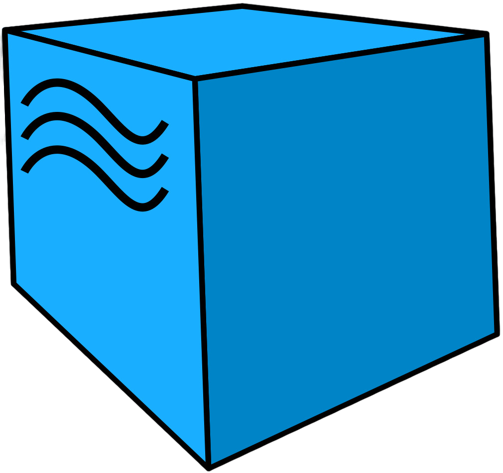
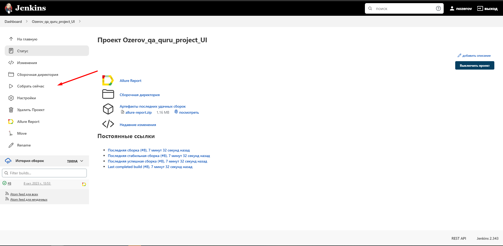
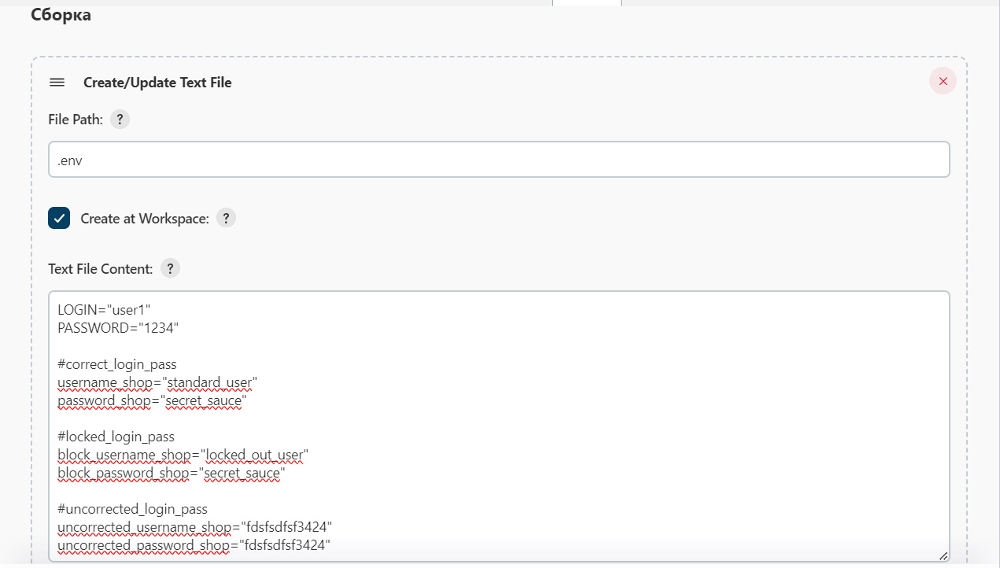
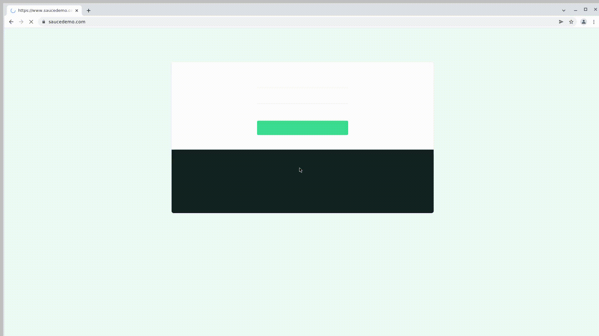
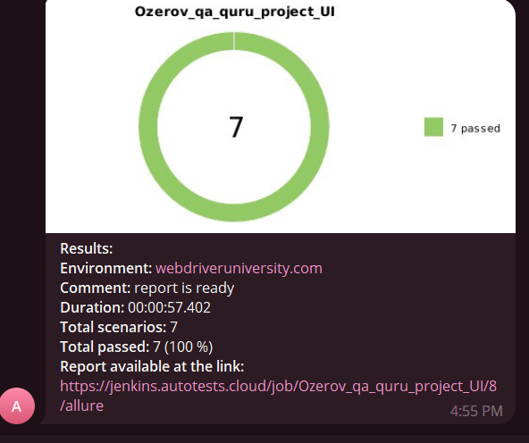

# UI test automation project for the "https://www.saucedemo.com/" demo online store
> www.saucedemo.com is a set of training pages that mimic an online store.

### Tech stack
<p  align="center">
  <code></code>
  <code></code>
  <code></code>
  <code></code>
  <code></code>
  <code></code>
  <code></code>
  <code></code>
  <code></code>
  <code></code>
</p>

## Test coverage
- Successful login to the store.
- Login with empty fields.
- Login as a locked-out user.
- Login with invalid credentials.
- Adding an item to the cart.
- Removing an item from the cart.
- Checkout.


## Running tests
#### By default, all tests run remotely on Selenoid

### Local run
1. Clone the repository ($ git clone [Git repo](https://github.com/Obrams/qa_guru_project_UI))
2. Open the project in PyCharm
3. Run in the terminal
``` 
python -m venv .venv
source .venv/bin/activate
pip install -r requirements.txt
pytest .
```

### Running tests in [Jenkins](https://jenkins.autotests.cloud/job/Ozerov_qa_quru_project_UI)
Click "Build Now"
<p></p>

For a remote run, add a build step in the **Build** section that creates/updates the .env file with your account data for <code>www.saucedemo.com</code>(**username_shop**, **password_shop**, **block_username_shop**, **block_password_shop**, **uncorrected_username_shop**, **uncorrected_password_shop**).

Example <code>.env</code> file in [Jenkins](https://jenkins.autotests.cloud/job/Ozerov_qa_quru_project_UI/configure)


Note: the credentials are test data.

###  Allure test reports
#### For a local run:
Run in the terminal 
```
allure serve allure-results
``` 
#### For a Jenkins run
Click Allure Report or the report icon in a finished build
<p></p>

### Test report examples


#### A video is attached to the report for every UI test


### <p> Telegram</p>
<p>Test reports are sent to <a href='https://t.me/aqa_report_bot'>Telegram</a></p>

